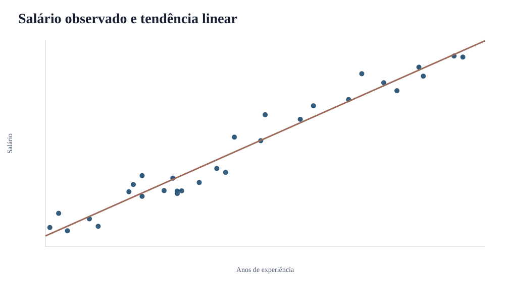
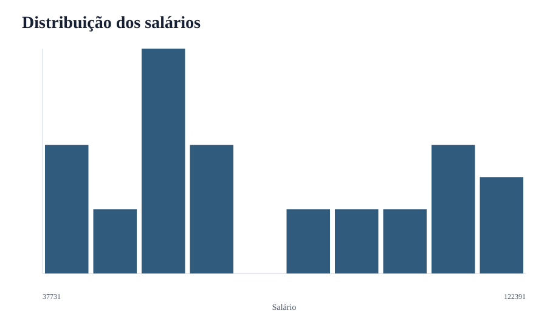
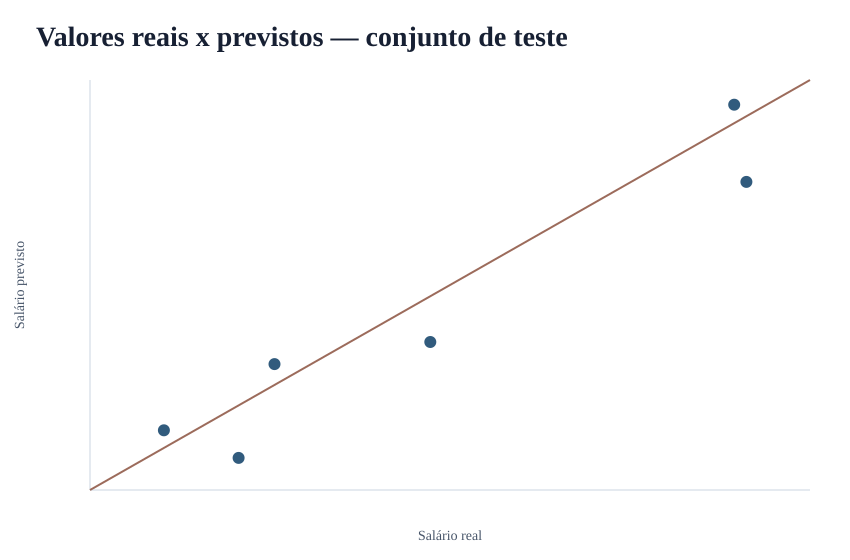
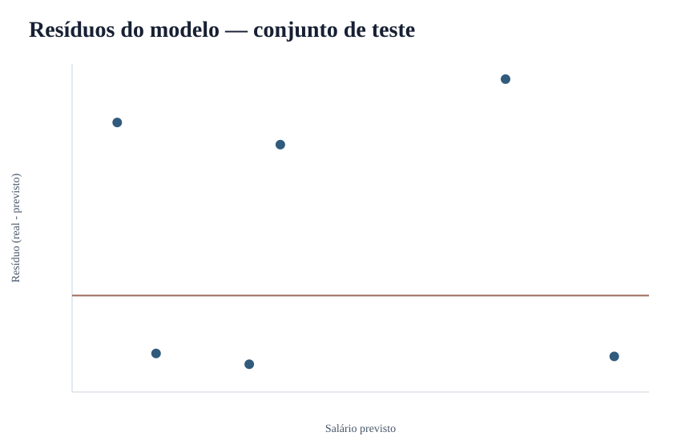

# Salary & Experience — Análise de Dados e Regressão Linear com Python

Projeto de portfólio em **Análise de Dados e Machine Learning com Python** que explora a relação entre anos de experiência e salário e testa uma regressão linear simples como modelo preditivo.

## Pergunta central

**Qual é a relação entre anos de experiência e salário nesta amostra, e até que ponto uma regressão linear consegue prever o salário?**

A análise é descritiva e preditiva. A associação encontrada **não deve ser interpretada como causalidade**.

## Dataset

A base possui:

- **30 observações**
- **2 variáveis**
- **0 valores ausentes**
- **0 duplicatas**
- experiência entre **1,1 e 10,5 anos**
- salário entre **37.731 e 122.391**
- salário médio de aproximadamente **76.003**

| Variável | Descrição |
|---|---|
| YearsExperience | anos de experiência |
| Salary | salário registrado |

> A base não informa país, moeda, setor ou cargo. Por isso, os valores são tratados como **unidades monetárias do dataset**.

## 1. Análise exploratória

A correlação de Pearson entre experiência e salário é de aproximadamente **0,978**, indicando uma associação linear positiva forte na amostra.



## 2. Distribuição salarial



A amostra cobre de 1,1 a 10,5 anos de experiência, mas contém somente 30 observações.

## 3. Modelo de regressão linear

A base foi separada em:

- **24 observações para treino**
- **6 observações para teste**
- `random_state=42` para reprodução do resultado

A equação estimada no conjunto de treino é:

```text
Salário previsto = 25.321,58 + 9.423,82 × anos de experiência
```

Dentro desta amostra, cada ano adicional de experiência está associado a aproximadamente **9.424 unidades monetárias** adicionais no salário previsto. Isso não representa efeito causal.

## 4. Desempenho no conjunto de teste

| Métrica | Resultado |
|---|---:|
| R² | 0,902 |
| MAE | 6.286,45 |
| RMSE | 7.059,04 |

O modelo explica aproximadamente **90,2%** da variação observada no pequeno conjunto de teste.



## 5. Validação cruzada

Como a amostra é pequena, também foi aplicada **validação cruzada com 5 folds**.

| Métrica média | Resultado |
|---|---:|
| R² | 0,922 |
| MAE | 4.726,55 |
| RMSE | 5.694,82 |

A validação cruzada reduz a dependência de uma única divisão treino/teste, embora não elimine a limitação do tamanho da amostra.

## 6. Resíduos



A análise de resíduos ajuda a verificar quanto cada previsão se afasta do valor observado e se há padrões evidentes de erro.

## Principais achados

1. Experiência e salário apresentam associação linear forte (`r ≈ 0,978`).
2. O modelo alcança `R² ≈ 0,902` no teste.
3. O erro absoluto médio no teste é de aproximadamente **6.286 unidades monetárias**.
4. A validação cruzada produz `R²` médio de aproximadamente **0,922**.
5. A amostra pequena e a ausência de outras variáveis limitam a generalização do modelo.

## Estrutura do projeto

```text
Salary-Experience-Analysis-Exploratory-Data-Analysis-and-Linear-Regression-with-Python/
├── .github/
│   └── workflows/
│       └── python-tests.yml
├── data/
│   └── raw/
│       └── salary_data.csv
├── notebooks/
│   └── salary_experience_regression.ipynb
├── reports/
│   ├── figures/
│   │   ├── actual_vs_predicted.svg
│   │   ├── residuals.svg
│   │   ├── salary_distribution.svg
│   │   └── salary_vs_experience.svg
│   ├── methodology.md
│   └── summary.json
├── src/
│   ├── __init__.py
│   ├── analysis.py
│   └── model.py
├── tests/
│   └── test_model.py
├── pytest.ini
├── requirements.txt
├── LICENSE
├── .gitignore
└── README.md
```

## Como executar

```bash
python -m venv .venv
```

No Windows:

```bash
.venv\Scripts\activate
```

No Linux/macOS:

```bash
source .venv/bin/activate
```

Instale:

```bash
pip install -r requirements.txt
```

Execute a análise:

```bash
python -m src.analysis
```

Ou abra:

```text
notebooks/salary_experience_regression.ipynb
```

## Testes

```bash
pytest -q
```

## Tecnologias

- Python
- Pandas
- NumPy
- Matplotlib
- Scikit-learn
- Jupyter Notebook
- Pytest
- GitHub Actions

## Competências demonstradas

- análise exploratória de dados;
- correlação;
- regressão linear;
- divisão treino/teste;
- R², MAE e RMSE;
- validação cruzada;
- análise de resíduos;
- organização de projeto reproduzível;
- testes automatizados e CI.

## Limitações

- somente 30 observações;
- apenas uma variável explicativa;
- ausência de país, moeda, cargo, setor, formação, empresa e localização;
- extrapolações além de 1,1–10,5 anos de experiência não são recomendadas;
- o projeto é didático e não deve ser usado para definir salários reais.

## Autor

**Pablo Sena**

GitHub: [@pablosena28](https://github.com/pablosena28)
